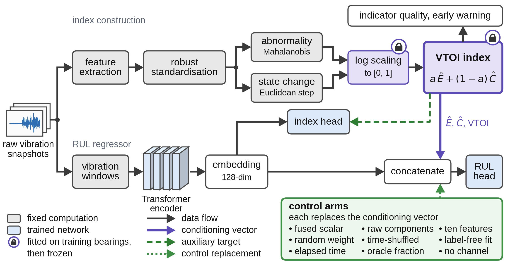
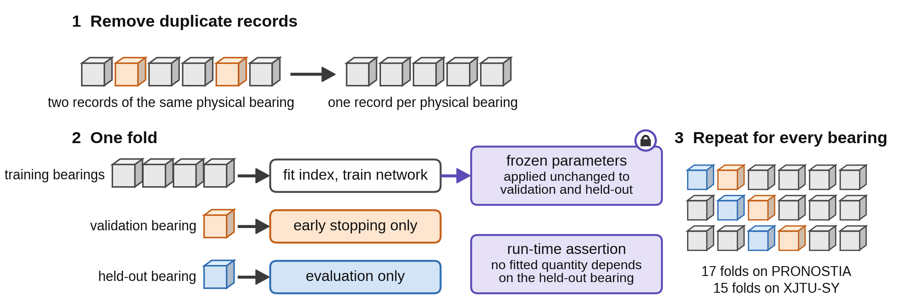
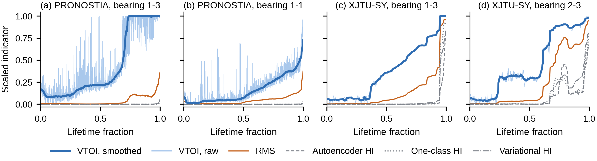
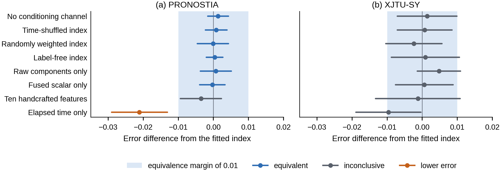
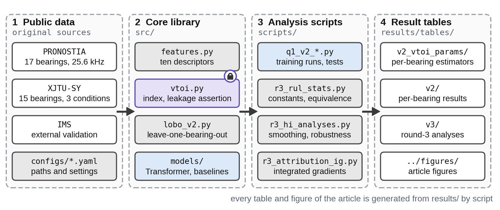

# VTOI - Vibration-based Temporal Observation Index


Reproducibility package for the article

> **VTOI: Controlled Attribution of a Transparent Vibration Health Index in Leakage-Aware
> Bearing Prognostics.** Cao-Phuc Ha and Phu-Nguyen Le. *IEEE Access*, under review.

VTOI is a transparent, vibration-only health index for rolling-element bearings. It combines a
Mahalanobis abnormality score with a state-change magnitude through one convex weight fitted on
training bearings. The study measures, under a leakage-free leave-one-bearing-out protocol, how
good the index is as a health indicator and how much it actually contributes when it is supplied
to a deep remaining-useful-life (RUL) regressor.

## Overview



*Fig. 1 of the article. Upper path: construction of the index; the padlocks mark
quantities fitted on the training bearings and then frozen. Lower path: the conditioned
Transformer regressor. Each control arm replaces the conditioning vector and keeps everything
else fixed.*

## Main findings

- Under a leakage-free leave-one-bearing-out protocol the index scores well on monotonicity,
  trendability and prognosability, and most of this advantage comes from its log-compressed
  Mahalanobis component.
- Supplied as a conditioning input, the index does not change RUL accuracy. On PRONOSTIA every
  index-derived channel, and the removal of the channel, is statistically equivalent to the
  fitted index within a margin of 0.01 (two one-sided tests, Holm-corrected).
- Elapsed time alone gives a lower error than the index on PRONOSTIA, because the target is a
  function of the lifetime fraction.
- Once the inputs are normalised for scale, integrated gradients and direct interventions both
  show that the RUL output depends mainly on the vibration embedding rather than on the index.

## Evaluation protocol



*Fig. 2. Duplicate records are removed before any split. In each fold the index
and the network are fitted on the training bearings, one bearing is used only for early
stopping, and the held-out bearing only for evaluation. A run-time assertion
(`src/vtoi.py::assert_no_leakage`) fails if any fitted quantity depends on the held-out bearing.*

## Selected results



*Fig. 3. Indicator trajectories on four held-out bearings.*



*Fig. 6. Control battery: paired differences from the fitted index with 90% confidence
intervals; the shaded band is the equivalence margin of 0.01.*

## Repository map



| Path | What it is |
|---|---|
| `src/vtoi.py` | The index, including the leakage assertion `assert_no_leakage` |
| `src/lobo_v2.py` | The leakage-free leave-one-bearing-out driver |
| `src/`, `scripts/`, `configs/` | Features, models, losses, samplers, baselines and analysis scripts |
| `results/tables/v2_vtoi_params/` | Per-bearing estimator records: fitted weight, scaling bounds, covariance estimator, shrinkage and baseline size |
| `results/tables/v2/` | Fold definitions, per-fold and per-bearing results of the training runs |
| `results/tables/v3/` | Analyses added in the revision (equivalence tests, constant references, integrated gradients, smoothed criteria, sensitivity, robustness, matched recall, oracle budget, completed RUL tables and per-dataset Holm correction) |
| `results/figures/` | The figures of the article |

About the name: the project started with a multi-source index (MTOI) that also used
temperature. The study was later restricted to vibration and the index renamed VTOI; the
repository keeps its original name so that earlier links remain valid.

## Which file backs which table

| Article | File in `results/tables/` |
|---|---|
| Table 1 - indicator quality, raw and smoothed | `v3/hi_quality_smoothed.csv, v2/hi_quality_all.csv` |
| Table 2 - fitted weight and realised range | `v2/weights_distribution.csv, v2/vtoi_range.csv` |
| Table 3 - sensitivity to baseline fraction and scaling bounds | `v3/sensitivity.csv` |
| Table 4 - robustness to noise, gain error and drift | `v3/robustness.csv` |
| Table 5 - early warning at the train-selected operating points | `v2/early_warning_v2.csv` |
| Table 6 - precision at matched recall | `v3/ew_matched_recall.csv, v3/pr_curves.csv` |
| Table 7 - onset sensitivity | `v2/onset_sensitivity.csv` |
| Table 8 - RUL error with constant references and alpha-lambda accuracy | `v2/main_results.csv, v2/wilcoxon.csv, v3/constant_baselines.csv, v3/prognostic_metrics.csv, v3/rul_table_extras.csv` |
| Table 9 - factorial design and seed variability | `v2/factorial_2x2.csv, v2/seed_variability.csv` |
| Table 10 - classical regressors, Holm within each dataset | `v2/classical.csv, v3/classical_holm.csv` |
| Table 11 - control battery with equivalence tests | `v2/controls.csv, v3/equivalence.csv` |
| Table 12 - oracle arm under longer training | `v3/oracle_budget.csv` |
| Table 13 - conformal intervals, interventions and integrated gradients | `v2/conformal.csv, v3/attribution_ig.csv` |
| Table 14 - failure cases | `v2/failure_cases.csv` |
| Table 15 - IMS zero-shot transfer | `v2/ims_transfer_seed42.csv` |

## Definitions used in the article

The regression target is the capped normalised RUL, equal to one over the first forty per cent
of life and then decreasing linearly to zero (`src/labels.py`, column `RUL_capped`). The error
is the mean absolute error over the snapshots of a held-out bearing. The healthy baseline is
the first twenty per cent of a record with at least thirty snapshots and at most half the
record (`src/vtoi.py::compute_raw_components`). In the vibration-only model the conditioning
vector is concatenated with the 128-dimensional embedding and read by a two-layer RUL head.

## Getting started

```bash
git clone https://github.com/highptest1-36/bearing_MTOI.git
cd bearing_MTOI
pip install -r requirements.txt
```

The datasets are not redistributed. PRONOSTIA (IEEE PHM 2012 challenge), XJTU-SY and the IMS
bearing data (NASA Prognostics Data Repository) are available from their original sources;
paths are set in `configs/*.yaml`.

```bash
python3 scripts/q1_v2_tier3.py            # indicator quality, early warning, conformal
python3 scripts/q1_v2_stats.py            # Wilcoxon tests with Holm correction
python3 scripts/r3_rul_stats.py           # constant references, alpha-lambda, equivalence tests
python3 scripts/r3_rul_stats.py --tables  # completed RUL table, per-dataset Holm correction
python3 scripts/r3_hi_analyses.py --part quality|sens|robust|ew
python3 scripts/r3_mono_mechanism.py      # sign-count analysis of monotonicity
python3 scripts/r3_attribution_ig.py      # integrated gradients and interventions
python3 scripts/r3_oracle_budget.py       # oracle arm with longer training (GPU recommended)
```

## Citation

If you use this code or the result tables, please cite the article:

```bibtex
@article{ha2026vtoi,
  author  = {Ha, Cao-Phuc and Le, Phu-Nguyen},
  title   = {{VTOI}: Controlled Attribution of a Transparent Vibration Health Index in
             Leakage-Aware Bearing Prognostics},
  journal = {IEEE Access},
  year    = {2026},
  note    = {Under review}
}
```

## Contact

**Cao-Phuc Ha** - Department of Artificial Intelligence, FPT University, Ho Chi Minh City, Vietnam

- E-mail: [caophucai@gmail.com](mailto:caophucai@gmail.com)
- ORCID: [0009-0004-7024-5166](https://orcid.org/0009-0004-7024-5166)
- Questions, bug reports and requests for support with follow-up studies are welcome, by e-mail or
  through [GitHub issues](https://github.com/highptest1-36/bearing_MTOI/issues).

## Licence

Code is released for academic use. Please cite the article if you use it.
